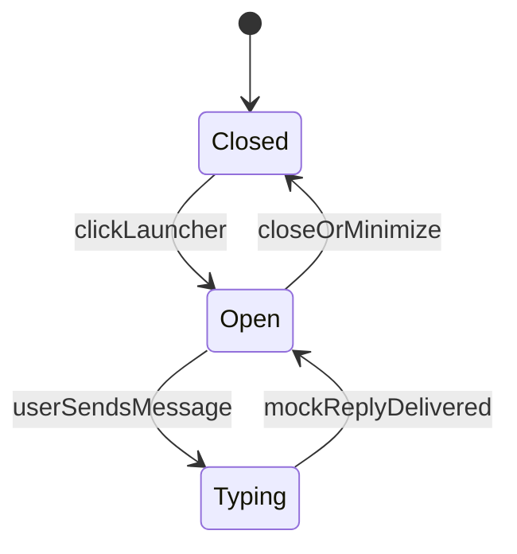

# Frontend чата ИИ-агента (виджет в стиле Jivo)

## Контекст

Репозиторий `[C:\AI\2.3\ai-chat](C:\AI\2.3\ai-chat)` сейчас без приложения (только правило мок-данных в `.cursor`). Реализуем **виджет**: круглая кнопка в правом нижнем углу, панель чата с шапкой, лентой сообщений и полем ввода — по UX, близкому к [Jivo](https://www.jivo.ru/).

## Стек


| Слой      | Выбор                                                                                                                                                                |
| --------- | -------------------------------------------------------------------------------------------------------------------------------------------------------------------- |
| Сборка    | **Vite** + **React 18** (JavaScript, без TypeScript — меньше порог входа)                                                                                            |
| Стили     | **CSS-переменные** + один глобальный `[src/styles/tokens.css](src/styles/tokens.css)` для светлой/тёмной темы; модули `[*.module.css](src/components)` у компонентов |
| Состояние | React `useState` / `useReducer` в `[src/chat/useChat.js](src/chat/useChat.js)` (без Redux)                                                                           |
| Моки      | `[src/chat/mockAgent.js](src/chat/mockAgent.js)` + начальная история в `[src/data/mockMessages.js](src/data/mockMessages.js)`                                        |


Демо-страница `[index.html](index.html)` имитирует «сайт клиента»: контент-заглушка + виджет поверх.

## UX и поведение (как у Jivo)




- **Launcher**: FAB с иконкой чата; при непрочитанных (опционально) — badge (можно заложить на будущее, в v1 badge после первого ответа агента при закрытом виджете).
- **Панель**: ~380×520px, скругления, тень; на узких экранах — почти на весь экран снизу.
- **Шапка**: имя агента («Алексей, ИИ-ассистент»), статус «В сети», кнопки: переключатель темы, свернуть/закрыть.
- **Лента**: приветствие агента + 3–5 стартовых сообщений из моков; пузыри user справа / agent слева; время `HH:MM`; аватар агента в шапке и у первого сообщения в группе.
- **Ввод**: textarea + отправка по Enter (Shift+Enter — перенос); кнопка «Отправить»; disabled пока идёт «ответ агента».
- **Typing**: «Агент печатает…» на 0.8–2 с перед мок-ответом.
- **Быстрые ответы** (chips под полем ввода): 3–4 фразы («Как оформить заказ?», «Связаться с оператором») — по клику подставляют текст и отправляют.

## Мок-логика агента

`[mockAgent.js](src/chat/mockAgent.js)`:

- `getMockReply(userText, messageHistory)` — ключевые слова (заказ, доставка, цена, оператор) + случайный ответ из пулов; иначе нейтральный fallback.
- `delay(ms)` + `simulateTyping(onStart, onEnd, replyText)` — возвращает Promise с текстом ответа.
- Без реальных секретов; тексты на **русском**, правдоподобные для поддержки/продаж.

Флаг на будущее (не ломая моки):

```javascript
export const USE_MOCK = true;
```

## Тема (светлая / тёмная)

- Атрибут `data-theme="light" | "dark"` на `document.documentElement`.
- `[src/theme/useTheme.js](src/theme/useTheme.js)`: чтение `localStorage` (`ai-chat-theme`), инициализация при загрузке, toggle в шапке виджета.
- Токены: фон панели, текст, акцент (зелёно-бирюзовый в духе Jivo), пузыри, border, shadow.

## Структура файлов

```
ai-chat/
  package.json
  vite.config.js
  index.html
  public/avatar-agent.svg
  src/
    main.jsx
    App.jsx                    # демо-лендинг + <ChatWidget />
    styles/
      tokens.css
      global.css
    data/
      mockMessages.js
    chat/
      useChat.js
      mockAgent.js
      types.js                 # JSDoc-константы ролей message
    components/
      ChatWidget/
        ChatWidget.jsx
        ChatWidget.module.css
      ChatLauncher/
      ChatPanel/
      ChatHeader/
      MessageList/
      MessageBubble/
      ChatComposer/
      QuickReplies/
      TypingIndicator/
```

## Доступность и полировка

- `role="dialog"`, `aria-label` для панели, фокус в поле ввода при открытии.
- Плавное появление панели (`transform` + `opacity`).
- `scrollIntoView` для последнего сообщения.

## Проверка после реализации

1. `npm install` → `npm run dev` — виджет на демо-странице.
2. Открыть/закрыть, отправить текст, chips, дождаться typing и ответа.
3. Переключить тему, обновить страницу — тема сохраняется.
4. Узкая ширина viewport — панель не обрезается.

## Вне scope v1 (можно позже)

- Реальный `/api/chat`, SSE-стриминг, вложения файлов, звук уведомлений, IIFE-сборка для вставки `<script>` на чужой сайт, i18n.

